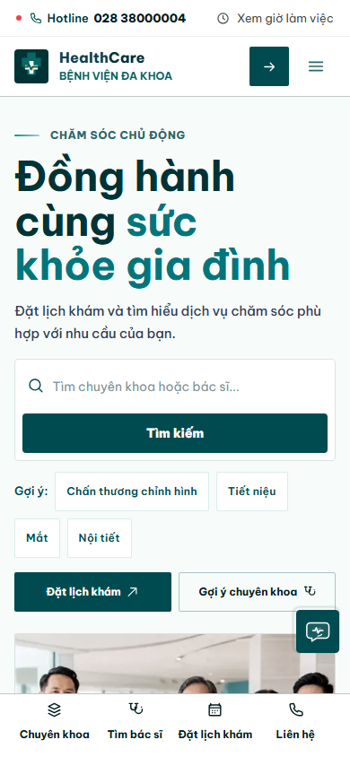
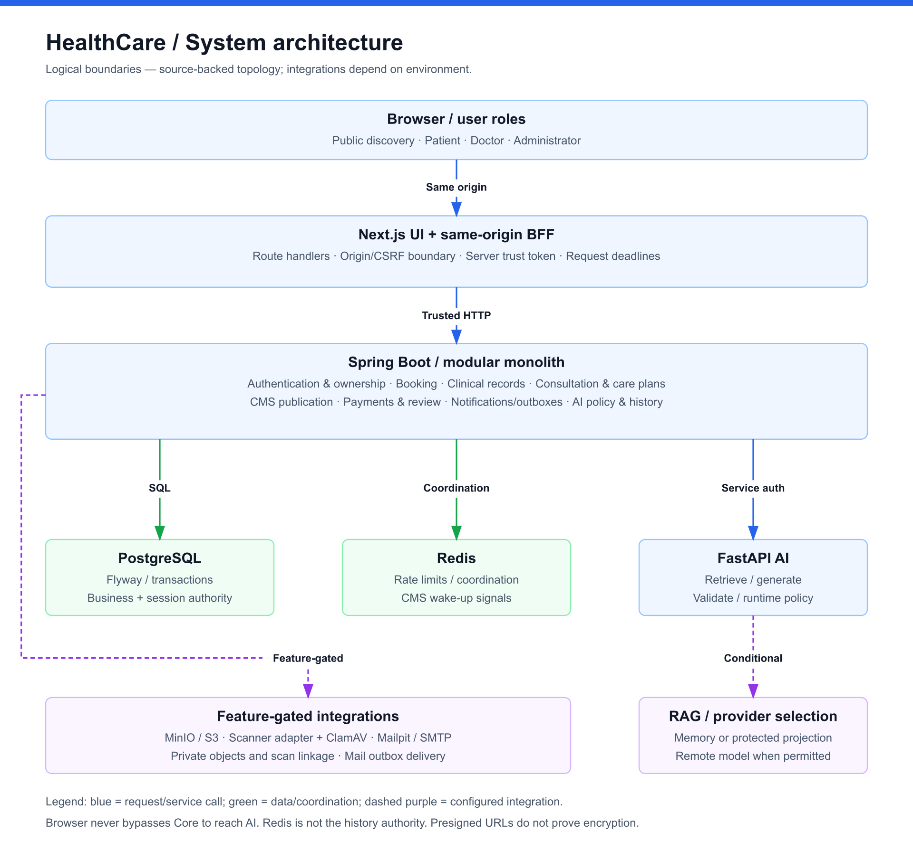

# HealthCare

### Nền tảng bệnh viện số · Đặt lịch · Hồ sơ khám · Trợ lý AI

Một không gian chung cho **bệnh nhân, bác sĩ và quản trị viên**, từ tìm cơ sở khám đến theo dõi lịch hẹn, hồ sơ và nội dung y tế.

[Website](https://www.healthcare.id.vn) · [Bộ tài liệu](docs/README.md) · [Chạy local](docs/getting-started.md) · [Kiến trúc](docs/architecture/system-overview.md)

> Dự án sử dụng dữ liệu minh họa. Ảnh/GIF dưới đây ghi từ stack demo local; chúng minh họa giao diện và không xác nhận hoạt động ngân hàng, điều trị thực tế hay trạng thái triển khai của website. AI hỗ trợ thông tin và phân luồng, không thay thế bác sĩ.

## Khám phá nhanh

- [Trải nghiệm và GIF](#trải-nghiệm-và-gif)
- [Nghiệp vụ theo vai trò](#nghiệp-vụ-theo-vai-trò)
- [Kiến trúc và điểm nhấn kỹ thuật](#kiến-trúc-và-điểm-nhấn-kỹ-thuật)
- [Chạy dự án](#chạy-dự-án)
- [Công nghệ và cấu trúc mã nguồn](#công-nghệ-và-cấu-trúc-mã-nguồn)
- [API và kiểm thử](#api-và-kiểm-thử)
- [Tài liệu chuyên sâu](#tài-liệu-chuyên-sâu)
- [Đóng góp và giấy phép](#đóng-góp-và-giấy-phép)

## Dự án giải quyết điều gì?

HealthCare tổ chức hành trình khám trong một hệ thống có nhiều cơ sở: tra cứu chuyên khoa và bác sĩ, chọn lịch phù hợp, xác nhận cuộc hẹn, theo dõi kết quả và trao đổi sau khám. Bác sĩ có cổng lâm sàng riêng; quản trị viên điều hành danh mục, lịch, nội dung, tài khoản và hàng đợi đối soát.

Các ranh giới kỹ thuật chính: giữ chỗ khi nhiều người chọn cùng khung giờ, quyền truy cập hồ sơ theo chủ sở hữu, phiên trình duyệt, xuất bản nội dung, lịch sử hội thoại AI và kiểm soát tệp đính kèm. Xem [phạm vi sản phẩm và thuật ngữ](docs/project-overview.md).

## Trải nghiệm và GIF

Các tour được ghi bằng trình duyệt thật trên localhost:3000, sử dụng dữ liệu seed giả lập. Video được chuyển sang GIF và giảm tốc độ khung hình để phù hợp GitHub. Không dựng giao diện hoặc thay API bằng mock. [Nguồn gốc và cách tái tạo media](docs/media-guide.md).

### Khám phá dịch vụ

Trang chủ → Chuyên khoa → Bác sĩ → Gói khám → Trang đặt lịch. Tour dừng ở giao diện lựa chọn; không tạo lịch hẹn.

| Trang chủ | Trải nghiệm mobile |
| --- | --- |
|  |  |

### Cổng bệnh nhân

Dashboard → Lịch hẹn → Lịch sử khám → Đơn thuốc → Trợ lý AI. Tour cho thấy màn hình đọc dữ liệu; không thực hiện thanh toán hoặc gửi thông tin sức khỏe mới.

| Dashboard bệnh nhân | Lịch sử khám |
| --- | --- |
|  |  |

### Cổng bác sĩ

Không gian lâm sàng → Lịch khám → Tư vấn → Kế hoạch chăm sóc → Bài viết. Mỗi vai trò sử dụng phiên trình duyệt riêng.

| Không gian lâm sàng | Kế hoạch chăm sóc |
| --- | --- |
|  |  |

### Cổng quản trị

Điều hành → Danh bạ bác sĩ → Tài khoản → CMS → Kiểm duyệt AI → Đối soát thanh toán. Tour chỉ mở màn hình; không lưu nội dung, đổi quyền hoặc duyệt giao dịch.

| Điều hành bệnh viện | Quản lý bác sĩ |
| --- | --- |
|  |  |

## Nghiệp vụ theo vai trò

| Vai trò | Hành trình chính | Tài liệu |
| --- | --- | --- |
| Khách | Tìm cơ sở, chuyên khoa, bác sĩ, gói khám, đọc bài viết; bắt đầu đặt lịch và hỏi thông tin bệnh viện | [Luồng đặt lịch](docs/business-workflows.md#đặt-lịch-và-giữ-chỗ) |
| Bệnh nhân | Lịch hẹn, hồ sơ, đơn thuốc, kết quả, tài liệu, tư vấn, chăm sóc, thông báo và hội thoại AI | [Cổng bệnh nhân](docs/project-overview.md#bệnh-nhân) |
| Bác sĩ | Lịch khám, ghi nhận lâm sàng, tư vấn, kế hoạch chăm sóc, bài viết và review nội dung AI | [Cổng bác sĩ](docs/project-overview.md#bác-sĩ) |
| Quản trị | Danh mục, lịch, tài khoản, CMS, hỏi đáp, tuyển dụng, đối soát và quản trị AI | [Cổng quản trị](docs/project-overview.md#quản-trị-viên) |

Có nhiều **chi nhánh trong cùng mô hình bệnh viện**. Không suy ra khả năng cô lập tenant của nhiều bệnh viện độc lập từ danh sách chi nhánh. Vai trò cũng không tự cấp quyền đọc mọi hồ sơ; backend kiểm tra quyền sở hữu và liên kết chuyên môn.

## Kiến trúc và điểm nhấn kỹ thuật

Luồng chính: **Browser → Next.js/BFF → Spring Boot → PostgreSQL hoặc AI service**. Spring là ranh giới nghiệp vụ và quyền truy cập; FastAPI xử lý AI phía sau ranh giới đó. Redis hỗ trợ giới hạn tần suất và realtime; MinIO/scanner/mail là các tích hợp phụ thuộc môi trường.

~~~mermaid
flowchart LR
    U[Khách / Bệnh nhân / Bác sĩ / Admin] --> W[Next.js UI]
    W --> B[BFF cùng origin]
    B --> S[Spring Boot API]
    S --> D[(PostgreSQL)]
    S --> R[(Redis)]
    S --> A[FastAPI AI]
    S --> O[Storage / scanner / mail]
~~~

- **Giữ chỗ và chống trùng lịch:** transaction, khóa advisory PostgreSQL và các ràng buộc lịch hoạt động. [Luồng và máy trạng thái](docs/business-workflows.md).
- **Phiên trình duyệt:** cookie phiên do server quản lý và CSRF cho yêu cầu thay đổi dữ liệu; API JWT có hợp đồng riêng. [Auth và BFF](docs/api-reference.md#xác-thực-và-phiên-trình-duyệt).
- **AI có nguồn và giới hạn:** phân biệt câu hỏi công khai với hội thoại bệnh nhân; consent, nguồn được duyệt, quota và hủy yêu cầu là các ranh giới riêng. [AI/RAG](docs/ai-system.md).
- **CMS xuất bản:** bản nháp, bản công khai và tín hiệu realtime có quyền hạn khác nhau. PostgreSQL giữ bản xuất bản; Redis đánh thức client. [CMS realtime](docs/architecture/cms-realtime.md).
- **Thanh toán cần đối soát:** gửi mã giao dịch hoặc nhận webhook đưa giao dịch vào hàng đợi; trạng thái đã trả tiền cần quyết định được phép. [Luồng thanh toán](docs/business-workflows.md#thanh-toán-và-đối-soát).
- **Tệp y tế có điều kiện:** bucket riêng, quyền truy cập, quét tệp và cờ tính năng. [Security](docs/security.md).

[Kiến trúc chi tiết](docs/architecture/system-overview.md) có phân tầng, deployment local/hosted, luồng auth/AI và nguồn Mermaid chỉnh sửa được. [Database](docs/database/schema-overview.md) có ERD tách theo miền.

## Chạy dự án

Yêu cầu Git và Docker Engine/Compose v2. Chạy từng dịch vụ trực tiếp cần Node.js/npm theo engines của frontend, Java 21 và Python 3.12. Thực hiện từ thư mục gốc repo.

~~~powershell
if (-not (Test-Path .env)) { Copy-Item .env.example .env }
# Điền cấu hình server-only bắt buộc; xem Getting started.
docker compose -p healthcare-local-demo --env-file .env -f infrastructure/docker-compose.yml -f infrastructure/docker-compose.local-demo.yml config --quiet
docker compose -p healthcare-local-demo --env-file .env -f infrastructure/docker-compose.yml -f infrastructure/docker-compose.local-demo.yml up -d --build
~~~

[Getting started](docs/getting-started.md) nêu các nhóm cấu hình, health check và cách tránh ghi đè stack đang dùng. Không chạy với ô bí mật bắt buộc còn trống.

| Điểm truy cập local | Mục đích |
| --- | --- |
| http://localhost:3000 | Website và BFF |
| http://localhost:8080/actuator/health | Health backend |
| http://localhost:8025 | Mailpit, email thử nghiệm |
| http://localhost:9001 | MinIO console local |
| localhost:5434 | PostgreSQL local, cổng host mặc định |

Compose khai báo cổng AI loopback mặc định `127.0.0.1:8000`, có thể đổi bằng `AI_SERVICE_HOST_PORT`; AI vẫn chỉ gắn network internal. Port declaration không chứng minh kết nối host đã hoạt động trên mọi runtime. [Compose](infrastructure/docker-compose.yml) là nguồn chính xác.

### Tài khoản trải nghiệm local

| Vai trò | Tài khoản seed | Trang sau đăng nhập |
| --- | --- | --- |
| Bệnh nhân | patient@healthcare.com | /patient/dashboard |
| Bác sĩ | doctor@healthcare.com | /doctor/dashboard |
| Quản trị | admin@healthcare.com | /admin |

Mật khẩu demo và binding hồ sơ nằm trong [runbook local](docs/local-demo-runbook.md). Chỉ dùng với seed giả lập của stack local. Nút điền nhanh phụ thuộc cờ build demo; không suy ra tài khoản seed được bật trên website public.

## Công nghệ và cấu trúc mã nguồn

| Thành phần | Công nghệ | Nguồn phiên bản/cấu hình |
| --- | --- | --- |
| Web | Next.js, React, TypeScript, Tailwind, TinyMCE, SortableJS, Chart.js | [package.json](apps/frontend/package.json) |
| Core API | Spring Boot, Java 21, Spring Security, JPA, Flyway | [pom.xml](apps/backend/pom.xml) |
| AI | FastAPI, Pydantic, provider/embedding adapters | [requirements](apps/ai-service/requirements.txt), [pyproject](apps/ai-service/pyproject.toml) |
| Local data và phụ trợ | PostgreSQL, Redis, MinIO, Mailpit, ClamAV, scanner adapter | [Compose](infrastructure/docker-compose.yml) |
| Automation | GitHub Actions và Docker images | [workflows](.github/workflows) |

| Thư mục | Đọc khi cần |
| --- | --- |
| [apps/frontend](apps/frontend) | Trang, UI, BFF và browser tests |
| [apps/backend](apps/backend) | Module nghiệp vụ, security, migration và Java tests |
| [apps/ai-service](apps/ai-service) | Routing AI, retrieval, provider và Python tests |
| [infrastructure](infrastructure) | Compose, scanner, image và fixture infrastructure |
| [supabase](supabase) | Projection/RLS và reconciliation có điều kiện |
| [scripts](scripts) | Preflight, chạy local, backup/restore và verification |
| [docs](docs/README.md) | Tài liệu người đọc |
| `plans/` (local, Git ignored) | Kế hoạch và bằng chứng theo phiên |

## API và kiểm thử

Browser dùng /api/v1/* cùng origin website. Không gửi service token đến client. [API reference](docs/api-reference.md) dẫn đến controller/DTO và phân biệt browser session, JWT, API công khai, API theo vai trò và đường nội bộ.

~~~powershell
# Frontend, từ apps/frontend
npm ci
npm run verify

# Backend, từ apps/backend sau preflight môi trường test
.\mvnw.cmd -B verify

# AI, từ apps/ai-service với environment đã cài requirements
python -m pytest
python -m ruff check .
python -m mypy
~~~

[Testing](docs/testing.md) giải thích điều kiện PostgreSQL/MinIO/Docker, rendered tests, E2E và CI. Đây là hướng dẫn lệnh, không phải báo cáo rằng toàn bộ suite vừa chạy.

## Tài liệu chuyên sâu

| Nhu cầu | Tài liệu |
| --- | --- |
| Sản phẩm, vai trò, thuật ngữ | [Product overview](docs/project-overview.md) |
| Cài đặt lần đầu | [Getting started](docs/getting-started.md) |
| Hệ thống và deployment | [System architecture](docs/architecture/system-overview.md) |
| Booking, clinical, payment, AI governance | [Business workflows](docs/business-workflows.md) |
| Bảng và quan hệ | [Database/ERD](docs/database/schema-overview.md) |
| API và auth contracts | [API reference](docs/api-reference.md) |
| Retrieval, consent, provider | [AI system](docs/ai-system.md) |
| Trust boundaries | [Security](docs/security.md) |
| Test, review và CI | [Testing](docs/testing.md) |
| Deploy, backup và phục hồi | [Operations](docs/operations.md) |
| Đóng góp đúng scope | [Contributing](docs/contributing.md) |
| Tái tạo ảnh/GIF và sơ đồ | [Media guide](docs/media-guide.md) |

## Đóng góp và giấy phép

Đọc [Contributing](docs/contributing.md) và [AGENTS.md](AGENTS.md) trước khi sửa repo. Tách thay đổi theo miền, bảo toàn dữ liệu và chỉ báo gate đã thực sự chạy. Mã nguồn theo [MIT License](LICENSE).
