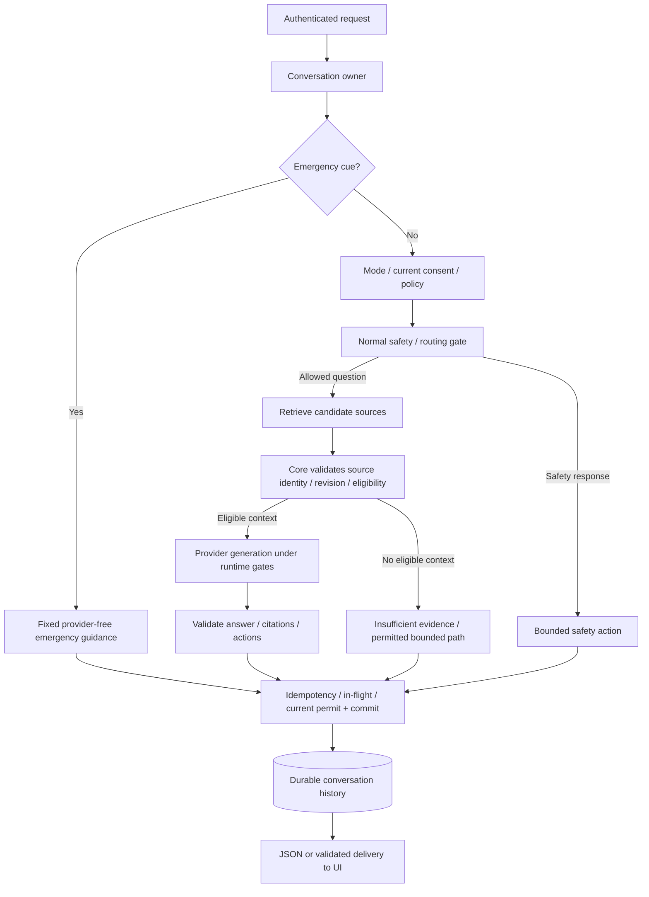

# Trợ lý AI và RAG

[Tài liệu](README.md) · [Security](security.md) · [AI service README](../apps/ai-service/README.md)

## Mục đích và hai bề mặt

Public support giúp khám phá thông tin bệnh viện từ danh mục; patient chat có conversation/history và hợp đồng consent. Không đồng nhất “AI trả lời được” với “model có quyền đọc mọi dữ liệu của bệnh viện”.

| Bề mặt | Owner | Ranh giới |
| --- | --- | --- |
| Public | [PublicAiChatController](../apps/backend/src/main/java/com/healthcare/ai/controller/PublicAiChatController.java) | Catalog support, không mở dữ liệu private |
| Patient | [AiConversationService](../apps/backend/src/main/java/com/healthcare/ai/chat/service/AiConversationService.java) | Owner, mode, consent, quota, history và request lifecycle |
| Provider/retrieval | [FastAPI app](../apps/ai-service/app) | Runtime/configuration, bounded context và response validation |

## Các mode và safety action

`HOSPITAL_SUPPORT`, `SYMPTOM_TRIAGE`, `HEALTH_EDUCATION` có mục đích khác nhau; các clinical mode phụ thuộc feature flags và eligibility. [ChatMode](../apps/backend/src/main/java/com/healthcare/ai/chat/entity/ChatMode.java) và [application config](../apps/backend/src/main/resources/application.yml) là owners.

Safety action gồm `ANSWER`, `REFUSE`, `EMERGENCY`, `HUMAN_HANDOFF`, `INSUFFICIENT_EVIDENCE`. Chúng mô tả cách xử lý lượt, không phải diagnosis. [ChatMedicalSafety](../apps/backend/src/main/java/com/healthcare/ai/chat/service/ChatMedicalSafety.java) và [FastAPI chatbot](../apps/ai-service/app/chatbot.py) sở hữu logic; docs không nhân bản lexicon y tế.

## Luồng một lượt patient chat

Hướng dẫn khẩn cấp cố định được nhận diện **sau ownership, trước mode/current-consent gates**; mode bị tắt hoặc consent cũ không biến crisis cue thành lỗi thuần túy. Nhánh này không gọi provider và vẫn chịu idempotency/in-flight/commit gates. Chi tiết đường uncited/local/safety thuộc service và cấu hình. Nguồn chính: [AiConversationService](../apps/backend/src/main/java/com/healthcare/ai/chat/service/AiConversationService.java), [source resolver](../apps/backend/src/main/java/com/healthcare/ai/chat/service/AiChatSourceResolver.java), [commit permits](../apps/backend/src/main/java/com/healthcare/ai/chat/service/ChatCommitPermitService.java), [BFF](../apps/frontend/lib/server/healthcare-bff.ts).

## Nguồn và citation

Citation dựa trên source identity được lưu/index, không phải URL hoặc doctor ID model tự sáng tác. Core kiểm tra nguồn có còn được phép dùng và phù hợp context. Catalog actions như chọn bác sĩ/slot vẫn cần backend resolve.

Public catalog mirror và clinical projection khác authority. Nội dung active/published công khai không tự mang approval lâm sàng. [Review workflow](business-workflows.md#kiểm-duyệt-nguồn-ai) liên kết revision/hash/expiry/outbox owners.

## Storage backend và consistency

| Lựa chọn | Hợp đồng |
| --- | --- |
| Memory | Phù hợp local/ephemeral catalog index; restart có thể mất trạng thái |
| Supabase durable adapter | Protected schema/table/RPC contract; credential server-only |
| Primary SQL | Sở hữu business data và conversation history; không bị thay bởi vector index |

[supabase_rag.py](../apps/ai-service/app/supabase_rag.py), [rag.py](../apps/ai-service/app/rag.py) và [AI README](../apps/ai-service/README.md) sở hữu adapter selection và fallback. Reconciliation/index sync có lag và giới hạn; không tuyên bố search luôn phản ánh mọi thay đổi SQL tức thời.

## Local, hosted và provider

Compose demo chọn local provider và internal-only network. Hosted manifest có provider/storage flags khác local; đọc [render-free-beta.yaml](../render-free-beta.yaml), [config.py](../apps/ai-service/app/config.py) và [llm.py](../apps/ai-service/app/llm.py) cùng nhau.

Tên biến như kill switch hoặc release hold không tự chứng minh một gate đang chặn đường cụ thể; cần kiểm tra consumer trong nguồn. Credential hiện diện, readiness green và một lượt provider thật là ba loại bằng chứng riêng.

Fallback deterministic chỉ được phép theo runtime/policy của adapter. Khi nguồn durable/provider không sẵn sàng và policy yêu cầu đóng, không trả một câu tự tin từ cache cũ chỉ để UI xanh.

## Consent, credits và cancellation

Consent version/timestamp ghi nhận contract hội thoại. Consent không cấp role hoặc mở private medical records. Xem [conversation controller](../apps/backend/src/main/java/com/healthcare/ai/chat/controller/AiConversationController.java).

Credits có ledger/policy riêng: lượt provider, safety/local response, debit/refund và retry không được đồng nhất. [AiCreditService](../apps/backend/src/main/java/com/healthcare/ai/service/AiCreditService.java) sở hữu accounting; UI chỉ trình bày số dư.

Request cancellation/lease/commit permit giữ lifecycle server khớp browser. Đóng tab hoặc cancel không chỉ là dừng hiệu ứng đánh máy; kiểm tra các owners trong [chat service directory](../apps/backend/src/main/java/com/healthcare/ai/chat/service) và [cancellation.py](../apps/ai-service/app/cancellation.py).

## Streaming và history

SSE có thể chuyển các chunk của câu trả lời đã validate. Nó không tự chứng minh provider gửi token trực tiếp, đặc biệt khi chunk flag tắt và client quay về JSON. History phải giữ provenance/citation/disclosure hợp lệ khi reload; không dùng animation đánh máy làm bằng chứng model đã chạy.

## Kiểm chứng đúng mức

| Muốn khẳng định | Cần evidence |
| --- | --- |
| UI chat đã render | Browser role route và ảnh/frame |
| Ownership đúng | Negative request từ owner khác |
| Source eligibility đúng | Approved/revoked/expired/revision mismatch cases |
| Cancellation đúng | Deterministic interruption/commit schedule |
| Provider đã gọi | Lượt thật với provenance/accounting, cấu hình và trace đã redacted |
| Durable retrieval | Database-backed adapter query và fail-closed case |

[AI tests](../apps/ai-service/tests), [Java AI tests](../apps/backend/src/test/java/com/healthcare/ai) và [Testing](testing.md) là điểm vào. GIF patient tour chỉ mở màn hình chat, không gửi lượt hoặc tiêu credits.
