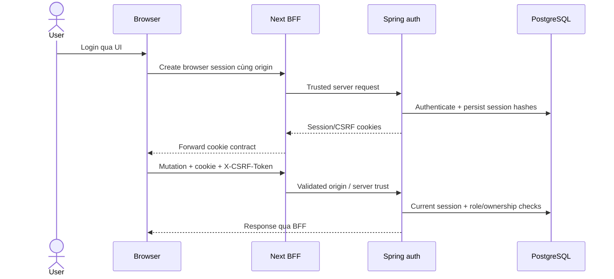

# API và hợp đồng xác thực

[Tài liệu](README.md) · [Security](security.md) · [Nghiệp vụ](business-workflows.md)

## Cách tìm contract chính xác

Browser gọi đường `/api/v1/*` trên origin website; [BFF](../apps/frontend/lib/server/healthcare-bff.ts) chuyển đến Spring. API method/path/DTO thuộc controller và schema, không thuộc danh sách URL được sao chép trong một báo cáo cũ.

Tìm endpoint và DTO từ repo root:

```powershell
rg -n 'RequestMapping|GetMapping|PostMapping|PutMapping|PatchMapping|DeleteMapping' apps/backend/src/main/java/com/healthcare
```

Mỗi endpoint cần đọc cả annotation ở class và method. ID trong ví dụ là placeholder; không dùng ID fixture hoặc booking code để bỏ qua quyền sở hữu.

## Xác thực và phiên trình duyệt

| Contract | Entry point | Điều cần phân biệt |
| --- | --- | --- |
| Browser session | `POST /api/v1/auth/browser-sessions` | Server-issued session, không phải JWT được trả cho JavaScript giữ tùy ý |
| Current session | `GET /api/v1/auth/browser-sessions/current` | Đọc identity hiện hành |
| Browser logout | `DELETE /api/v1/auth/browser-sessions/current` | Thu hồi phiên và cookie |
| JWT APIs | `/auth/login`, `/auth/refresh`, `/auth/logout` | Contract riêng cho token client |
| Google proof | `/auth/google/proof` | Proof cần server validation; UI provider không tự xác nhận backend login |
| Verification/reset | Các method trong AuthController | Accepted mail request khác delivered email |

Nguồn: [AuthController](../apps/backend/src/main/java/com/healthcare/auth/AuthController.java), [BrowserSessionService](../apps/backend/src/main/java/com/healthcare/auth/service/BrowserSessionService.java), [session filter](../apps/backend/src/main/java/com/healthcare/auth/security/BrowserSessionAuthenticationFilter.java).



Session cookie là HttpOnly, Secure, SameSite Lax với path root; CSRF cookie có contract đọc được cho header. [BrowserCsrfFilter](../apps/backend/src/main/java/com/healthcare/auth/security/BrowserCsrfFilter.java) và [BffRequestVerifier](../apps/backend/src/main/java/com/healthcare/auth/security/BffRequestVerifier.java) sở hữu kiểm tra. Không ghi cookie/token vào network trace hoặc docs.

## Bản đồ miền API

| Miền | Controller owner | Contract cần đọc cùng |
| --- | --- | --- |
| Danh mục công khai và admin | [Hospital controllers](../apps/backend/src/main/java/com/healthcare/hospital/controller) | Filter/pagination, active/public và quyền admin |
| Booking | [AppointmentController](../apps/backend/src/main/java/com/healthcare/appointment/controller/AppointmentController.java) | DTO hold/confirm, OTP, expiry và owner/phone proof |
| Clinical patient/doctor | [Clinical controllers](../apps/backend/src/main/java/com/healthcare/clinical/controller) | Role + patient/doctor linkage |
| Care plan | [Careplan controllers](../apps/backend/src/main/java/com/healthcare/careplan/controller) | Plan/items và appointment eligibility |
| Consultation | [Consultation module](../apps/backend/src/main/java/com/healthcare/consultation) | Participants, lifecycle và attachment scan |
| Payment | [Payment controllers](../apps/backend/src/main/java/com/healthcare/payment/controller) | Patient submit, admin review/refund, webhook/invoice |
| CMS | [CMS controllers](../apps/backend/src/main/java/com/healthcare/cms/controller) | Draft/published/page layout/events |
| Notifications | [Notification module](../apps/backend/src/main/java/com/healthcare/notification) | Owner, preferences và realtime/email distinction |
| Public AI | [PublicAiChatController](../apps/backend/src/main/java/com/healthcare/ai/controller/PublicAiChatController.java) | Bounded message/context, public-support source policy |
| Patient AI | [AiConversationController](../apps/backend/src/main/java/com/healthcare/ai/chat/controller/AiConversationController.java) | Conversation owner, mode, consent, idempotency, cancellation |
| Governance/credits | [AI controllers](../apps/backend/src/main/java/com/healthcare/ai/controller) | Review revision/hash, credit authority |
| Media/files | [Storage](../apps/backend/src/main/java/com/healthcare/storage), [media](../apps/backend/src/main/java/com/healthcare/media) | Upload flags, MIME/scan, private object and authorization |

## Booking paths để lần theo luồng

Trong AppointmentController: GET doctor slots → POST hold → OTP resend nếu cần → POST confirm. Tra cứu/hủy/đổi lịch theo booking code có proof/ownership riêng. [Booking DTOs](../apps/backend/src/main/java/com/healthcare/appointment/dto) xác định body; không tự dùng `appointmentId` thay `bookingCode`.

## Hai đường AI

Public: `POST /api/v1/public/ai/chat` là hỗ trợ thông tin công khai. Patient: `/api/v1/ai/conversations` có create/list/read, messages, consent, feedback, delete và delivery routes. Không dùng public chat để truy cập medical record.

Prepare/commit/lease/cancellation control plane là giao tiếp nội bộ giữa server, không phải API mà browser hoặc bên thứ ba tự gọi. [healthcare-bff.ts](../apps/frontend/lib/server/healthcare-bff.ts) kiểm soát đường private; [AI contracts](../apps/backend/src/main/java/com/healthcare/ai/chat/dto/ChatContracts.java) sở hữu shape.

## Lỗi và retry

Đọc error code/HTTP status từ contract; ví dụ 401 cho auth, 403 cho quyền/trust boundary, 409 cho xung đột nghiệp vụ, 503 khi dependency không sẵn sàng. Không hiển thị raw provider error hoặc secret cho người dùng.

BFF có chính sách retry riêng theo method/deadline. Không tự retry mutation booking/payment với body mới vì một response bị mất; caller phải giữ hợp đồng idempotency của endpoint. [API client](../apps/frontend/lib/api-client.ts) và [BFF](../apps/frontend/lib/server/healthcare-bff.ts) là owners.

## Kiểm chứng API

Thử qua browser thật hoặc cùng-origin BFF với session/CSRF đúng contract. Một request direct Spring bị từ chối khi thiếu server trust không chứng minh endpoint nghiệp vụ hỏng. Một request thành công với role admin cũng không chứng minh patient ownership đúng.

[Testing](testing.md) liên kết integration/negative cases. Không commit bearer token, request cookie, service token hoặc private test identity để biến tài liệu thành collection có secrets.
