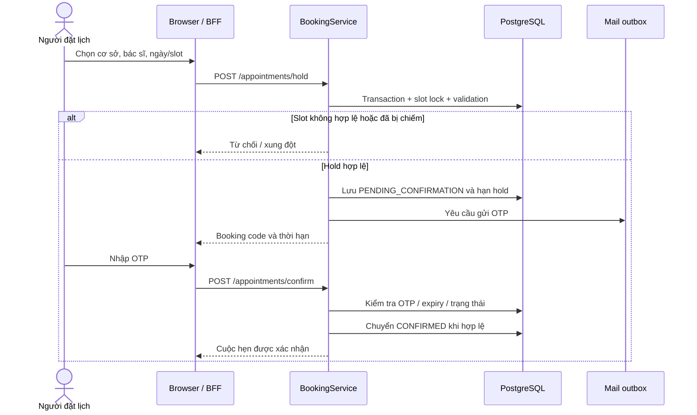
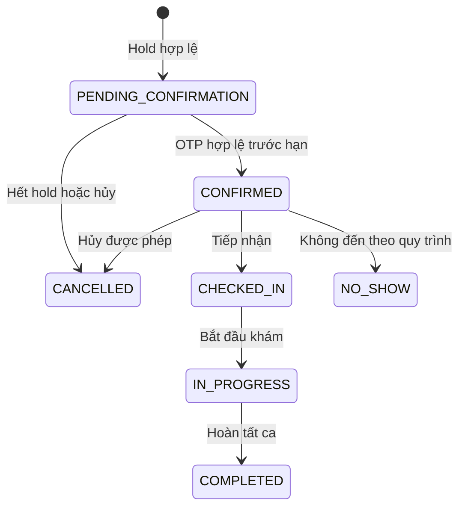
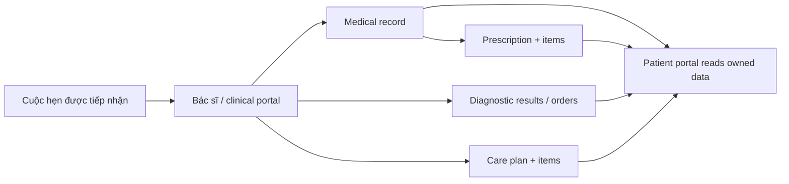
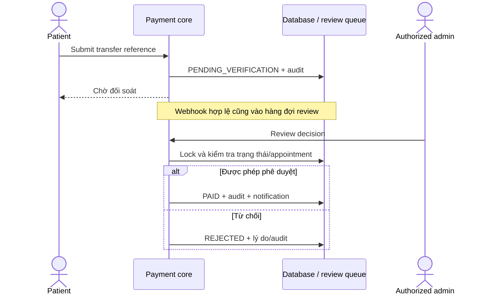
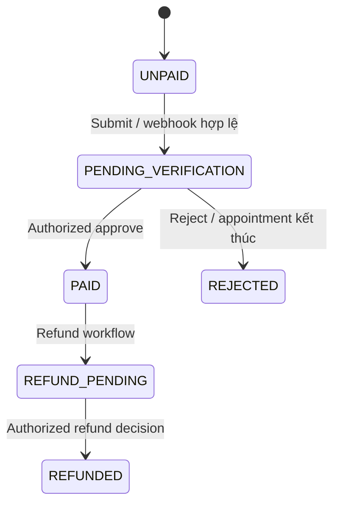
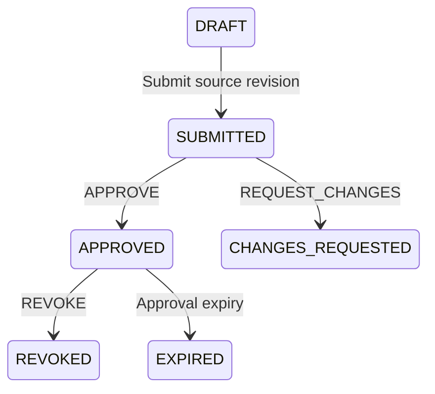
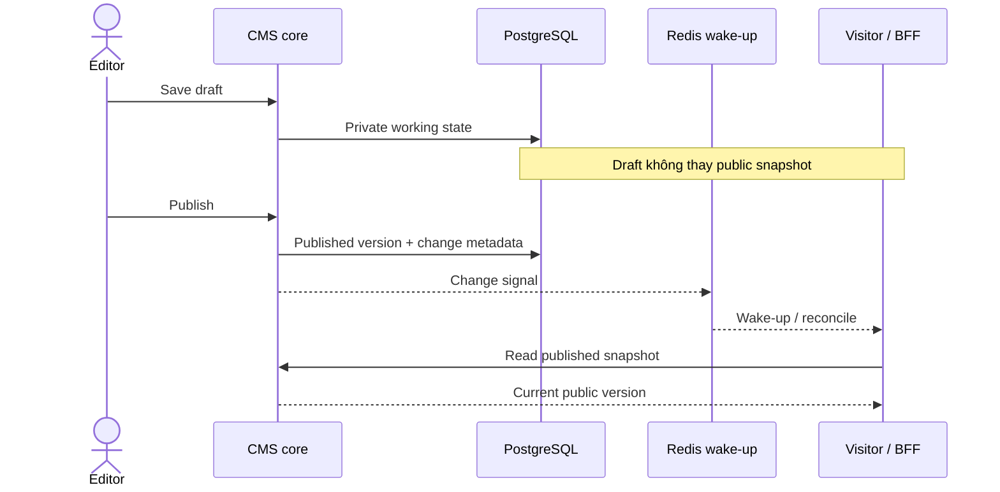

# Luồng nghiệp vụ và máy trạng thái

[Tài liệu](README.md) · [API](api-reference.md) · [Database](database/schema-overview.md)

Các sơ đồ là bản đọc nghiệp vụ của những đường đi chính, không thay thế mọi nhánh kiểm tra trong service. Điều kiện, actor và response cụ thể thuộc executable owners dưới mỗi sơ đồ.

## Đặt lịch và giữ chỗ

### Vì sao tách giữ chỗ và xác nhận?

Một người chọn khung giờ chưa có nghĩa cuộc hẹn đã được xác nhận. Hold bảo vệ chỗ trong thời gian xử lý OTP; transaction và database invariants bảo vệ hai request cạnh tranh cùng khung giờ. Không dựa vào nút disabled ở browser để bảo đảm chống trùng.

Nguồn: [AppointmentController](../apps/backend/src/main/java/com/healthcare/appointment/controller/AppointmentController.java), [BookingService](../apps/backend/src/main/java/com/healthcare/appointment/service/BookingService.java), [Postgres slot locker](../apps/backend/src/main/java/com/healthcare/appointment/service/PostgresAppointmentSlotLocker.java), [repository](../apps/backend/src/main/java/com/healthcare/appointment/repository/AppointmentRepository.java).

Hạn chờ lock có giới hạn. Việc bảo vệ slot còn phụ thuộc constraint và transaction, không chỉ một từ khóa “pessimistic lock”. [ADR-003](adr/ADR-003-appointment-concurrency.md) lưu rationale; migrations là contract hiện tại.

### Vòng đời cuộc hẹn

Đây là luồng điển hình. [AppointmentStatus](../apps/backend/src/main/java/com/healthcare/appointment/entity/AppointmentStatus.java) định nghĩa các trạng thái; [portal/admin services](../apps/backend/src/main/java/com/healthcare/appointment/service) sở hữu các chuyển trạng thái được phép. Hết hạn hold không tạo một enum `EXPIRED` của appointment; [HoldSweeper](../apps/backend/src/main/java/com/healthcare/appointment/service/AppointmentHoldSweeper.java) xử lý lifecycle đó.

Tra cứu, hủy và đổi lịch cần owner hoặc proof đúng contract. Đổi lịch không phải cập nhật ngày bất kỳ: target slot vẫn phải hợp lệ và giữ các invariant về bác sĩ/chi nhánh/khung giờ.

## Khám và theo dõi sau khám

Các nhánh thể hiện những loại dữ liệu liên quan, không bắt buộc mọi ca đều có đơn thuốc, chẩn đoán hoặc kế hoạch chăm sóc. Một record, prescription hoặc diagnostic result có quyền đọc riêng theo linkage; UI không tự quyết định quyền.

Nguồn: [ClinicalService](../apps/backend/src/main/java/com/healthcare/clinical/service/ClinicalService.java), [clinical controllers](../apps/backend/src/main/java/com/healthcare/clinical/controller), [CarePlanService](../apps/backend/src/main/java/com/healthcare/careplan/service/CarePlanService.java), [DocumentService](../apps/backend/src/main/java/com/healthcare/document/service/DocumentService.java).

Tài liệu lâm sàng tổng hợp phải giữ nhãn minh họa khi xem/tải. Consultation là kênh người bệnh–bác sĩ, không phải chat AI; xem [consultation module](../apps/backend/src/main/java/com/healthcare/consultation).

## Thanh toán và đối soát

### Các bằng chứng không tương đương

| Sự kiện | Ý nghĩa |
| --- | --- |
| Patient nhập mã giao dịch | Khai báo để đối soát |
| Webhook ngân hàng được chấp nhận | Nhận sự kiện hợp lệ để xử lý/đối soát |
| Admin quyết định hợp lệ | Cho phép chuyển trạng thái theo policy |
| Biên nhận | Tài liệu theo contract thanh toán, không chứng minh gateway thật đã được chạy trong demo |
| Dashboard demonstration | Quyết định mô phỏng trên graph fixture được sở hữu |

Sơ đồ tóm tắt, không phải danh sách exhaustive transitions. [PaymentStatus](../apps/backend/src/main/java/com/healthcare/payment/entity/PaymentStatus.java), [BankTransferPaymentService](../apps/backend/src/main/java/com/healthcare/payment/service/BankTransferPaymentService.java), [WebhookService](../apps/backend/src/main/java/com/healthcare/payment/service/BankTransferWebhookService.java) và [state-machine tests](../apps/backend/src/test/java/com/healthcare/payment/BankTransferPaymentStateMachineTest.java) sở hữu oracle.

Webhook cần contract signature/replay/retry riêng; không dùng URL endpoint làm chứng cứ tích hợp bank thành công. [DashboardDemonstrationGuard](../apps/backend/src/main/java/com/healthcare/demo/DashboardDemonstrationGuard.java) tách graph mô phỏng khỏi giao dịch thông thường.

## Kiểm duyệt nguồn AI

Nội dung công khai và nguồn được phép đưa vào AI không đồng nghĩa. Một source revision/hash mới cần eligibility phù hợp; revoke hoặc expiry phải loại nguồn khỏi retrieval dù lịch sử đã từng approve.

Các round/revision tiếp theo do service quyết định; không vẽ một vòng quay tự động mà source không cho phép. [AiClinicalReviewService](../apps/backend/src/main/java/com/healthcare/ai/service/AiClinicalReviewService.java) sở hữu decision vocabulary và round; [ExpiryService](../apps/backend/src/main/java/com/healthcare/ai/service/AiClinicalReviewExpiryService.java) sở hữu expiry; [clinical outbox](../apps/backend/src/main/java/com/healthcare/ai/service/AiClinicalOutboxService.java) chuyển UPSERT/TOMBSTONE đến projection.

## CMS và realtime

Polling, SSE và reconnect có thể có đường đi khác nhau. Redis availability không xác nhận browser đã đọc snapshot mới. [CMS realtime](architecture/cms-realtime.md) sở hữu contract preview/origin/cache/reconciliation.

## Điểm kiểm chứng khi demo

| Luồng | Bằng chứng cần để nói “đã chạy” |
| --- | --- |
| Booking | Hold/confirm thật và lifecycle persist trong fixture dùng một lần |
| Clinical | Actor hợp lệ, record persist, patient đọc đúng owner |
| Payment | Đúng loại fixture/giao dịch, decision/audit và trạng thái sau reload |
| AI | Consent/source/provider/provenance và history đúng lượt |
| CMS | Draft không đổi public; publish được public đọc lại |

GIF trong README là tour màn hình đọc dữ liệu; không tuyên bố đã chạy tất cả mutation trên. [Testing](testing.md) dẫn đến bài kiểm thử cho các boundary này.
